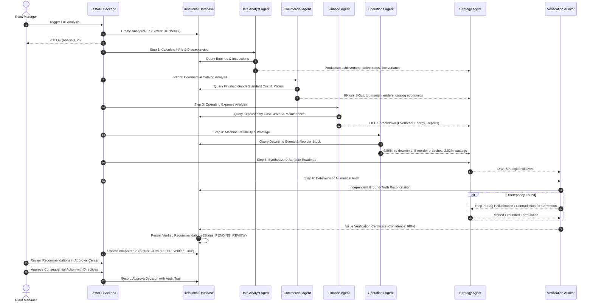

# System Architecture & Technical Specifications
## Smart Manufacturing – Production & Quality Intelligence Platform

---

## 1. Architectural Overview & Design Principles

The platform follows a layered, decoupled enterprise architecture designed for data integrity, deterministic verification, and scalability:

```
+-----------------------------------------------------------------------------------+
|                              PRESENTATION LAYER (React.js)                        |
|   - 12 Enterprise Pages (Executive Dashboard, Quality, Machines, Chat, etc.)     |
|   - Recharts Visualizations & Tailwind CSS Navy/Light-Grey Styling               |
|   - Axios Interceptors with Bearer JWT State Management                           |
+-----------------------------------------------------------------------------------+
                                        │ HTTPS
                                        ▼
+-----------------------------------------------------------------------------------+
|                              API & BUSINESS ENGINE (FastAPI)                      |
|   - REST API Endpoints with Pydantic Data Validation & RBAC Route Protection      |
|   - Pandas/NumPy Deterministic KPI Service (Zero Double Counting)                 |
|   - Background Task Execution for Multi-Agent Workflows                          |
|   - ReportLab Multi-Page PDF Generation Engine                                    |
+-----------------------------------------------------------------------------------+
             │                                                           │
             ▼                                                           ▼
+───────────────────────────+                               +───────────────────────────+
|     MULTI-AGENT LAYER     |                               |   MACHINE LEARNING LAYER  |
|  (CrewAI + Verification)  |                               |   (Scikit-Learn Engine)   |
| - 6 Specialized Agents   |                               | - Production Regressor    |
| - Sequential Data Hand-off|                               | - Quality Risk Classifier |
| - Deterministic Auditor   |                               | - Isolation Forest Anom   |
| - 9-Attribute Recs        |                               | - Material Scrap Estimator|
+───────────────────────────+                               +───────────────────────────+
             │                                                           │
             └───────────────────────────┬───────────────────────────────┘
                                         ▼
+-----------------------------------------------------------------------------------+
|                              DATA PERSISTENCE LAYER                               |
|   - PostgreSQL (Production on Render) / SQLite (Local Zero-Config Fallback)       |
|   - SQLAlchemy 2.0 ORM with Normalized Relational Schema                          |
|   - 8 Normalized Tables + 5 Governance & Audit Tables                             |
+-----------------------------------------------------------------------------------+
```

---

## 2. Multi-Agent Collaboration & Verification Loop



---

## 3. Relational Schema & Table Relationships

The database is designed with complete third normal form (3NF) normalization where appropriate:

1. `finished_goods`:
   - `product_id` (PK), `product_name`, `product_category`, `standard_unit_cost`, `selling_price`, `target_cycle_time_minutes`.
2. `raw_materials`:
   - `material_id` (PK), `material_name`, `material_category`, `unit_cost`, `stock_quantity`, `reorder_level`, `supplier_id`.
3. `production_batches`:
   - `batch_id` (PK), `product_id` (FK -> `finished_goods.product_id`), `production_date`, `production_line`, `planned_quantity`, `produced_quantity`, `rejected_quantity`, `shift`, `batch_status`.
4. `quality_inspections`:
   - `inspection_id` (PK), `batch_id` (FK -> `production_batches.batch_id`), `inspection_date`, `inspected_units`, `defective_units`, `defect_type`, `inspector_id`, `inspection_result`.
5. `material_usage`:
   - `usage_id` (PK), `batch_id` (FK -> `production_batches.batch_id`), `material_id` (FK -> `raw_materials.material_id`), `usage_date`, `quantity_used`, `wastage_quantity`.
6. `machine_downtime`:
   - `downtime_id` (PK), `machine_id`, `event_date`, `production_line`, `downtime_minutes`, `reason`, `maintenance_cost`, `severity`.
7. `expenses`:
   - `expense_id` (PK), `expense_date`, `cost_center`, `category`, `amount`, `vendor`.
8. `users`:
   - `id` (PK), `username` (UK), `email` (UK), `hashed_password`, `full_name`, `role` (ADMIN, MANAGER, ANALYST), `is_active`, `created_at`.
9. `analysis_runs`:
   - `id` (PK), `trigger_type`, `status`, `started_at`, `completed_at`, `metrics_summary`, `executive_summary`, `verified`, `verification_notes`, `confidence_score`.
10. `agent_logs`:
    - `id` (PK), `analysis_id` (FK), `agent_name`, `agent_role`, `status`, `started_at`, `completed_at`, `input_context`, `output_text`, `structured_data`.
11. `recommendations`:
    - `id` (PK), `analysis_id` (FK), `problem`, `supporting_evidence`, `business_impact`, `recommended_action`, `priority`, `expected_benefit`, `implementation_timeline`, `responsible_department`, `kpi_to_monitor`, `status`, `created_at`.
12. `approval_decisions`:
    - `id` (PK), `recommendation_id` (FK), `user_id` (FK), `user_name`, `decision` (APPROVED, REJECTED), `comments`, `decided_at`.
13. `reports`:
    - `id` (PK), `analysis_id` (FK), `title`, `file_path`, `file_name`, `file_size_bytes`, `generated_at`, `status`, `metadata_payload`.
14. `dataset_import_history`:
    - `id` (PK), `file_name`, `file_type`, `record_counts`, `status`, `imported_at`, `error_details`.

---

## 4. Machine Learning Implementation Details

### Model 1: Production Regressor
- **Target**: `produced_quantity`
- **Algorithm**: `RandomForestRegressor(n_estimators=100, max_depth=12, random_state=42)`
- **Features**: `planned_quantity`, `target_cycle_time_minutes`, `production_line`, `shift`, `product_id`, `day_of_week`, `month`.
- **Validation**: 80/20 train/test split.
- **Performance**: $R^2 = 0.9348$, $\text{MAE} = 85.27$ units, $\text{RMSE} = 114.48$ units.

### Model 2: Quality Risk Predictor
- **Target**: `high_defect_risk` (binary classification $\ge 10\%$ defect rate) and `defective_units` (continuous regression).
- **Algorithm**: `RandomForestClassifier` & `RandomForestRegressor`.
- **Target Leakage Prevention**: Post-inspection measurements (`inspected_units`, `inspection_result`, `defect_type`) are strictly excluded. Only pre-production parameters (`planned_quantity`, `cycle_time`, `production_line`, `shift`, `product_id`) are supplied to the feature vector.
- **Performance**: Regressor $\text{MAE} = 9.84$ defective units.

### Model 3: Machine Downtime Anomaly Detector
- **Target**: Stoppage event anomalies.
- **Algorithm**: `IsolationForest(n_estimators=100, contamination=0.05, random_state=42)`.
- **Features**: `downtime_minutes`, `maintenance_cost`.
- **Output**: Anomaly score and binary classification ($-1$ for anomaly, $+1$ for normal). Flags top 60 extreme maintenance incidents.

### Model 4: Material Scrap Estimator
- **Target**: `wastage_quantity`
- **Algorithm**: `RandomForestRegressor(n_estimators=100, max_depth=10, random_state=42)`.
- **Features**: `quantity_used`, `unit_cost`, `material_id`, `material_category`.
- **Performance**: $\text{MAE} = 3.75$ kg/units.
